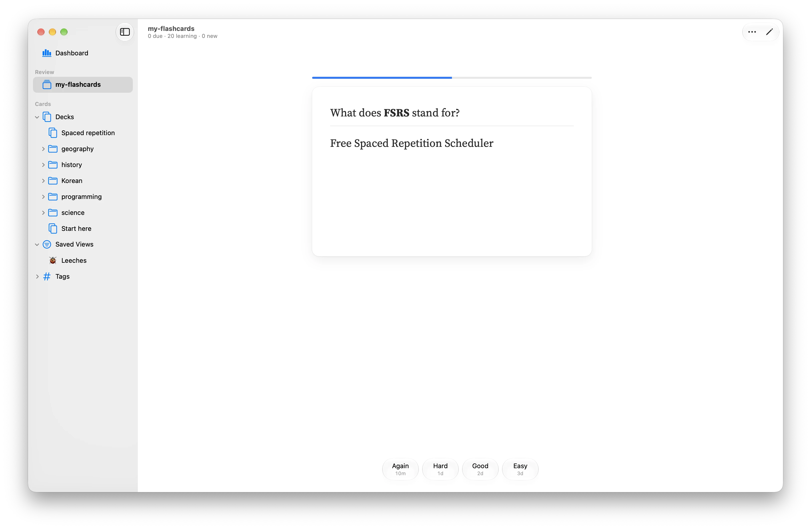

<p align="center">
  
</p>
<h1 align="center">Amgi</h1>

Plain-text flash cards, scheduled with [FSRS](https://github.com/open-spaced-repetition/fsrs4anki/wiki/The-Algorithm).

A collection is a folder with a `cards` folder of Markdown files inside. Each file is a
deck, and folders nest decks: the `lang` deck holds `cards/lang.md` and everything in
`cards/lang/`. Beside `cards` are `media` for images and sounds and `note-types` for
[notes with fields](docs/card-format.md#notes-with-fields); review history is stored
in `.amgi.sqlite`. Anything else in the folder, such as a README, is left alone.

```
README.md
cards/
  Spanish.md
  lang/Korean.md
media/
note-types/
```

<p align="center">
  
</p>

```markdown
Q: What does **FSRS** stand for?
A: Free Spaced Repetition Scheduler

C: The capital of [France] is [Paris|city].
```

`Q:` / `A:` makes a basic card; in a `C:` cloze each `[answer]` becomes its own card, and
`[answer|hint]` shows the hint. Cards can also hold images, sounds, math and highlighted
code, and you can import your Anki decks.

## Install

[Download the latest release](https://github.com/alisheryeginbay/amgi/releases/latest),
open the `.dmg` and drag Amgi into Applications. Needs macOS 26 on Apple Silicon.
Amgi checks for new versions itself and installs them in one click; you can also
choose Amgi ▸ Check for Updates….

## Build & run

Building needs macOS, Rust and [Bun](https://bun.sh).

```sh
make                         # build what changed, then run the app
cargo install --path cli     # the amgi command
```

## Docs

- [Card format](docs/card-format.md): cards, clozes, media, math, code, tags and suspending
- [Studying](docs/studying.md): shortcuts, browsing, adding cards, saved views and search
- [Importing from Anki](docs/anki-import.md)
- [Command line](docs/cli.md)
- [Contributing](CONTRIBUTING.md): project layout, building and tests

## License

[MIT](LICENSE). The fonts (Source Serif 4, Brygada 1918 and Noto Serif CJK) are
under the [SIL Open Font License](https://openfontlicense.org), and the emoji names
come from GitHub's [gemoji](https://github.com/github/gemoji) (MIT).
