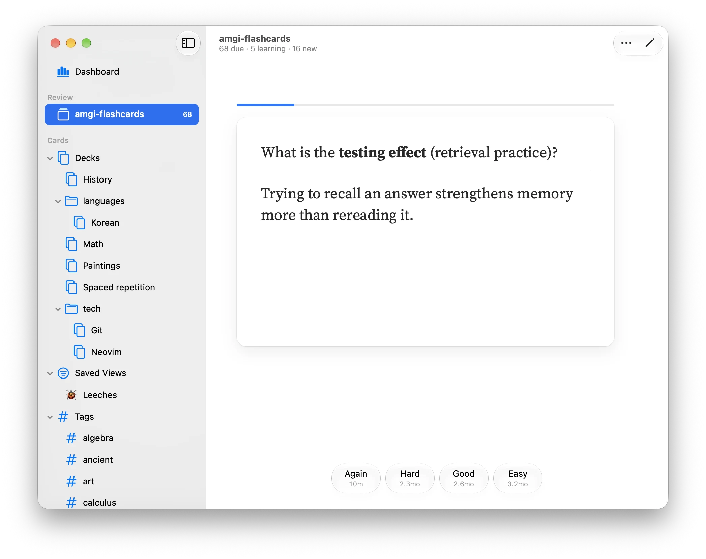
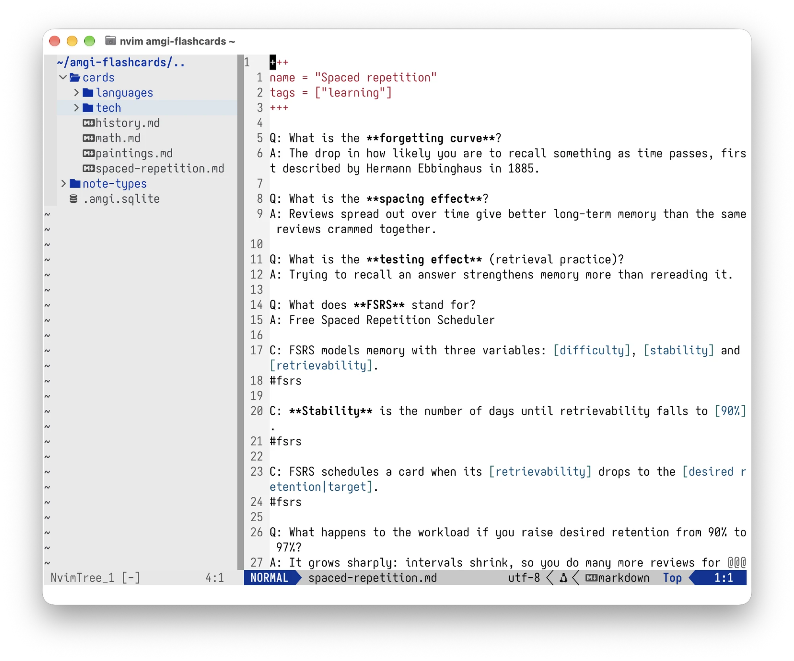
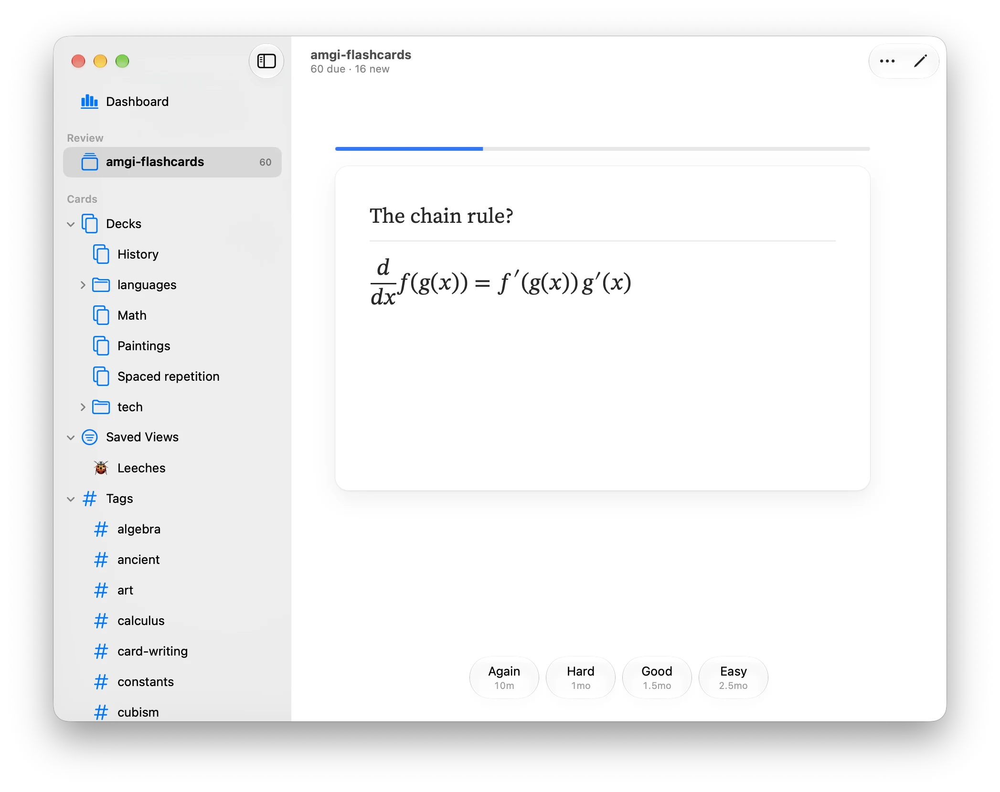
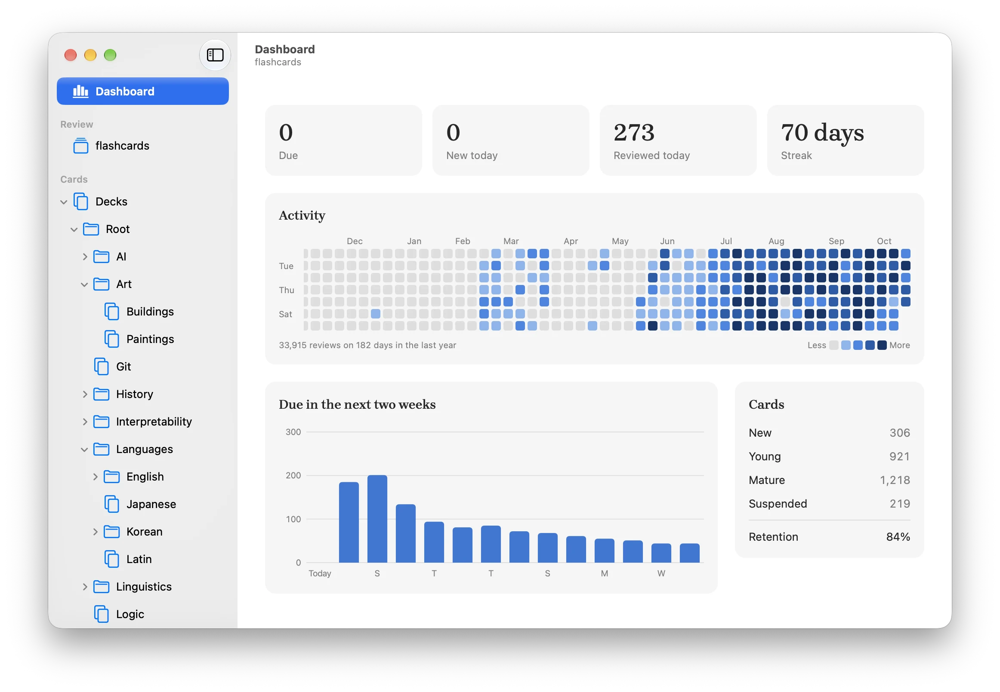
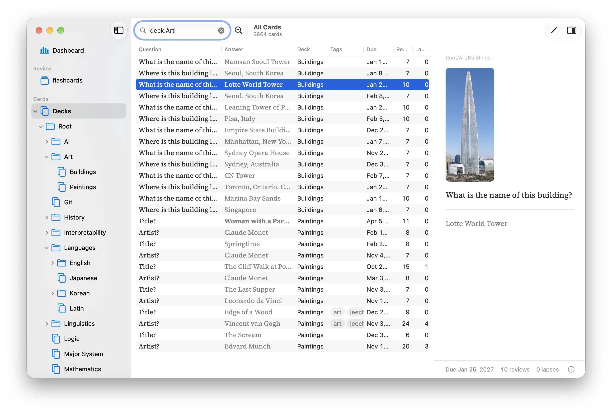

<p align="center">
  
</p>
<h1 align="center">Amgi</h1>

<p align="center">
  <b>Flash cards in plain Markdown files, scheduled with <a href="https://github.com/open-spaced-repetition/fsrs4anki/wiki/The-Algorithm">FSRS</a>.</b><br />
  A native macOS app for a folder of cards you can edit in any editor and keep in git.
</p>

<p align="center">
  <a href="https://github.com/alisheryeginbay/amgi/releases/latest"><b>Download for macOS</b></a>
  ·
  <a href="https://docs.amgi.study">Docs</a>
  ·
  <a href="https://docs.amgi.study/anki-import">Import from Anki</a>
</p>

<p align="center">
  
</p>

## Cards are text

```markdown
Q: What does **FSRS** stand for?
A: Free Spaced Repetition Scheduler

C: The capital of [France] is [Paris|city].
```

`Q:` / `A:` makes a basic card; in a `C:` cloze each `[answer]` becomes its own card, and
`[answer|hint]` shows the hint. There's no database of cards to export from: the files
are the cards, so you can write them in Vim, grep them, generate them with a script and
review the changes in a pull request.

<p align="center">
  
</p>

A collection is a folder with a `cards` folder of Markdown files inside. Each file is a
deck, and folders nest decks: the `lang` deck holds `cards/lang.md` and everything in
`cards/lang/`. Beside `cards` are `media` for images and sounds and `note-types` for
[notes with fields](https://docs.amgi.study/card-format#notes-with-fields); review
history is stored in `.amgi.sqlite`. Anything else in the folder is left alone.

```
README.md
cards/
  Spanish.md
  lang/Korean.md
media/
note-types/
```

## What it does

<table>
  <tr>
    <td width="50%"></td>
    <td width="50%"></td>
  </tr>
  <tr>
    <td colspan="2"></td>
  </tr>
</table>

- **Rich cards:** images, sounds, TeX math, code highlighted in 200+ languages, and
  [notes with fields](https://docs.amgi.study/card-format#notes-with-fields) that make
  several cards from one entry, such as word → meaning and meaning → word.
- **Browse and search** every card in a table: `deck:french #verbs is:due`,
  `lapses>3`, `is:leech`, and saved views for the searches you come back to.
- **Add a card from any app** with <kbd>⌥⌘N</kbd>, and see what's due from the menu bar.
- **Bring your Anki decks:** `.apkg` and `.colpkg` files become Markdown with their media
  and review history, and an [AnkiConnect](https://docs.amgi.study/yomitan) server lets
  Yomitan and other Anki tools add cards.
- **A command line:** `amgi status`, `check`, `search`, `stats`, and `diff` to list the
  cards added, changed and removed since a git commit.

## Install

[Download the latest release](https://github.com/alisheryeginbay/amgi/releases/latest),
open the `.dmg` and drag Amgi into Applications. Needs macOS 26 on Apple Silicon.
Amgi checks for new versions itself and installs them in one click.

## Build from source

Amgi is a Rust core with a SwiftUI app and Svelte panes in a web view. Building needs
macOS, Rust and [Bun](https://bun.sh).

```sh
make                         # build what changed, then run the app
cargo install --path cli     # the amgi command
```

See [CONTRIBUTING.md](CONTRIBUTING.md) for the project layout and tests.

## Docs

The full docs are at [docs.amgi.study](https://docs.amgi.study).

- [Card format](https://docs.amgi.study/card-format): cards, clozes, media, math, code, tags and suspending
- [Studying](https://docs.amgi.study/studying): shortcuts, browsing, adding cards, saved views and search
- [Importing from Anki](https://docs.amgi.study/anki-import)
- [Adding cards from Yomitan](https://docs.amgi.study/yomitan): AnkiConnect for Yomitan and other tools made for Anki
- [Command line](https://docs.amgi.study/cli)

## License

[MIT](LICENSE). The fonts (Source Serif 4, Brygada 1918 and Noto Serif CJK) are
under the [SIL Open Font License](https://openfontlicense.org), and the emoji names
come from GitHub's [gemoji](https://github.com/github/gemoji) (MIT).

*Amgi* (암기) is Korean for memorization.
